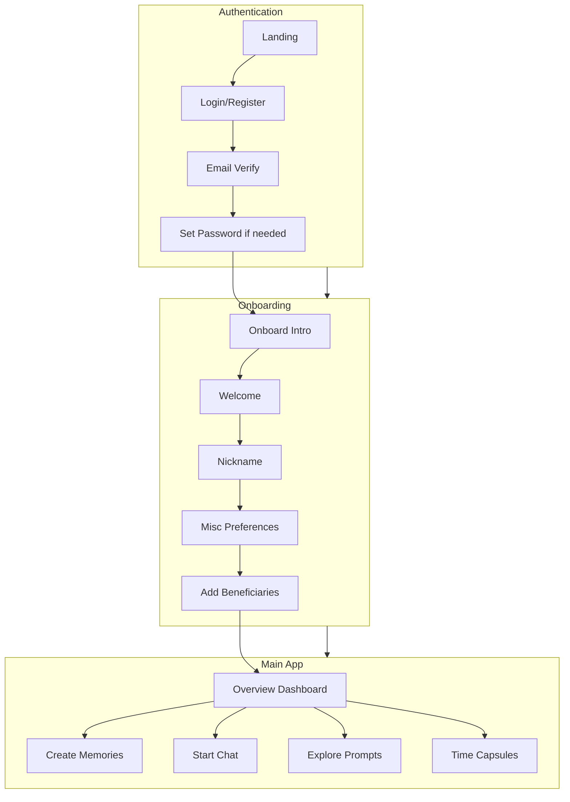

# Memento App – Full Product Requirements Document (PRD)

---

## 1. Executive Summary

**Memento** is a personal memory and legacy preservation web application. It enables users to capture, organize, and share life stories and memories with chosen beneficiaries, schedule future delivery via time capsules, and engage in AI-powered conversations about their memories.

**Tagline:** *"Your quiet space to reflect, to preserve, to remember"* — *"A safe, gentle memory box where all your life's experiences are cherished."*

**Target users:** Individuals who want to preserve personal stories, family history, and life experiences for future generations.

---

## 2. Product Vision and Goals

| Goal | Description |
|------|-------------|
| **Preservation** | Capture memories in multiple formats (text, audio, video, images, documents) |
| **Legacy** | Share memories with beneficiaries (people or groups) with controlled access |
| **Time capsules** | Schedule delivery of content at future dates |
| **Engagement** | AI chat for reflection and exploration of memories |
| **Gamification** | Streaks, XP, enrichment score, and prompts to encourage ongoing use |

---

## 3. User Personas and Journeys

### Primary Persona: Memory Keeper

- Wants to document life stories for family
- May prefer voice/video over typing
- Values privacy and controlled sharing

### Secondary Persona: Beneficiary

- Receives invite from benefactor
- Accepts invite and gains access to shared memories
- May view time capsules when delivered

### User Journey (High Level)



---

## 4. Feature Specifications

### 4.1 Authentication

| Feature | Description | Routes |
|---------|-------------|--------|
| Email/password login | Standard login with JWT | `/login` |
| Registration | New user signup | `/register` |
| Password reset | Request reset link | `/forget-password`, `/check-mail` |
| Email verification | Verify email after signup | `/verify-email`, `/confirm-email` |
| Set password | For invite flow or post-reset | `/set-password` |
| OAuth (Google) | Sign in with Google | `/auth/oauth/google` |
| Accept invite | Beneficiary accepts benefactor invite | `/accept-invite/:id` |

**Auth flow:** JWT stored in `localStorage` (`memento:auth`). Access token refresh via `/auth/refresh-token`. `AuthCheck` wrapper enforces auth on dashboard and onboard layouts.

---

### 4.2 Onboarding

**Current flow** (routes under `/onboard`):

| Step | Route | Purpose |
|------|-------|---------|
| Intro | `/onboard` | Value prop, "Let's go!" CTA |
| Welcome | `/onboard/welcome` | Feature overview |
| Nickname | `/onboard/nickname` | Set display nickname |
| Misc | `/onboard/misc` | Interests, reasons for joining |
| Beneficiary | `/onboard/beneficiary` | Add initial beneficiaries |

**Completion:** `complete-onboarding` API marks user as onboarded; redirect to `/overview`.

**Planned: Host Onboarding (Groot)** — A 5-step personalised flow at `/onboarding` that collects identity, motivation, content preferences, and life dimension priorities. See [Appendix A: Host Onboarding (Groot)](#appendix-a-host-onboarding-groot) for full specification.

---

### 4.3 Memories (Stories)

**Core entity:** `IMemory` — title, body (rich text), attachments, tags, type, status, level, groups, beneficiaries.

| Feature | Description |
|---------|-------------|
| Create memory | Modal: TipTap editor, emojis, links, slash commands, file upload (images, audio, video, docs), tags, access (groups/beneficiaries) |
| View/Edit/Delete | Full CRUD via modals |
| Audio recorder | In-app mic recording via `AudioRecorderModal` |
| Video recorder | In-app camera recording via `VideoRecorderModal` |
| AI tag generation | Auto-generate tags for memories |
| Search | Cmd/Ctrl+K opens `search-memory` modal |
| Bookmark | Toggle bookmark on memories |
| Share | Assign access to groups/beneficiaries |
| List view | Grid or table on `/stories` |
| Detail view | Single memory at `/stories/:id` |

**Attachments:** Images, audio, video, documents (PDF). Upload via `/files/upload`.

---

### 4.4 Chat (AI Conversations)

| Feature | Description |
|---------|-------------|
| Start conversation | From `/chat` landing: text + attachments |
| Conversation view | `/chat/:id` — streaming responses via Gemini |
| Voice input | Gemini Live API for voice chat |
| Background music | Optional ambient music |
| Chat settings | Voice selection, preferences |
| Recent conversations | `/chat/conversations` |
| Suggested topics | `/chat/conversations/suggested` |
| Reply to memory | `/chat/reply/:id` |

**Flow:** Start chat → `POST /ai/conversation/new` → returns `memory_id` → navigate to `/chat/:memory_id`. Messages streamed via `streamlineFetcher`.

---

### 4.5 Time Capsules

**Entity:** `ICapsule` — title, body, attachments, memories, recipients, `schedule_date`, status.

| Status | Description |
|--------|-------------|
| draft | Not yet scheduled |
| scheduled | Awaiting delivery |
| delivered | Sent to recipients |
| pause | Paused by user |
| failed | Delivery failed |
| deleted | Soft-deleted |

| Feature | Description |
|---------|-------------|
| Create/Edit | Modal with theme, date, recipients, content |
| View | Capsule details |
| Pause/Unpause | Change delivery status |
| Delete | Remove capsule |

**Route:** `/capsule` — TimeCapsulePage.

---

### 4.6 Beneficiaries and Groups

| Entity | Purpose |
|--------|---------|
| **Beneficiary** | Person who receives access to memories; has name, email, relationship, status |
| **Group** | Collection of beneficiaries; has name, description, members, color |

| Feature | Description |
|---------|-------------|
| Add/Edit/Delete beneficiary | CRUD modals |
| Resend invite | For pending beneficiaries |
| Add/Edit/Delete group | CRUD modals |
| Add group members | Assign beneficiaries to group |
| Select beneficiary | When assigning memory access |

**Invite flow:** Benefactor adds beneficiary → invite sent → beneficiary accepts at `/accept-invite/:id`.

---

### 4.7 Explore (Prompts)

| Feature | Description |
|---------|-------------|
| Browse categories | `/explore`, `/explore/categories`, `/explore/categories/:id` |
| Prompts | Guided questions to add memories |
| Earn points | Completing prompts awards XP |

**API:** `/prompts`, `/prompts/suggestions`, `/prompts/categories`, `/prompts/reply`.

---

### 4.8 Gamification

| Metric | Description |
|--------|-------------|
| **Streak** | Consecutive days of activity |
| **XP** | Points from prompts and activity |
| **Enrichment score** | 0–100% completion/quality metric |

Displayed in Overview header and Welcome section.

---

### 4.9 Settings

| Section | Features |
|---------|----------|
| Profile | Picture, name, preferences |
| Security | Change password, 2FA setup |
| Notifications | Preferences |
| Beneficiaries & Groups | Manage from settings |
| Privacy | Data controls |
| Delete account | Account deletion |
| Chat settings | Voices, background music |

---

### 4.10 Public Post

| Route | Purpose |
|-------|---------|
| `/post/:id` | Public view of a shared post (no auth required) |

---

## 5. Technical Architecture

### 5.1 Tech Stack

| Layer | Technology |
|-------|------------|
| Framework | React 19, TypeScript |
| Build | Vite 7 |
| Routing | react-router-dom v7 |
| State | React Context (Store), SWR for server state |
| API | Axios, `VITE_API_BASE_URL` |
| Styling | Tailwind CSS 4, CVA, Radix UI, Base UI |
| Rich text | TipTap |
| AI | Google Gemini (chat + live voice) |
| Media | react-media-recorder, pdfjs-dist, Three.js |
| Modals | Custom `useModal` + react-modal-sheet |
| Testing | Vitest, Testing Library, MSW, Playwright |
| Monitoring | Sentry |

### 5.2 Key Directories

```
src/
├── api/          # endpoint, fetcher, mutations, client
├── components/   # UI, modals, forms, Chatinput, recorder
├── hooks/        # use-store, use-modal, use-chat, use-fetcher, use-live-api
├── pages/        # auth, onboard, dashboard (overview, chat, stories, explore, capsule)
├── providers/    # Store, Modal, Chat, SWR, Toaster
├── utility/      # interface.ts, auth-service, constants
└── test/         # renderWithProviders, MSW handlers, auth helpers
```

### 5.3 Data Flow

```mermaid
flowchart LR
    subgraph frontend [Frontend]
        UI[Pages/Components]
        Store[Store Context]
        SWR[SWR Cache]
        Modal[Modal Stack]
    end

    subgraph api [API Layer]
        Fetcher[fetcher.ts]
        Endpoints[endpoint.ts]
    end

    subgraph backend [Backend]
        Auth[/auth/*]
        Users[/users/*]
        Memories[/memories/*]
        AI[/ai/*]
        Capsule[/capsule/*]
        Prompts[/prompts/*]
    end

    UI --> Store
    UI --> SWR
    UI --> Modal
    SWR --> Fetcher
    Fetcher --> Endpoints
    Endpoints --> backend
```

---

## 6. UI/UX Patterns

### 6.1 Layouts

| Layout | Use case |
|--------|----------|
| **AuthLayout** | Full-screen background, centered card for login/register |
| **OnboardLayout** | Centered column, no sidebar |
| **DashboardLayout** | Sidebar (250px) + header + main content; mobile slide-over |

### 6.2 Modal System

- **Stack-based:** `open(name, props)`, `push(name, props)`, `close(name?)`
- **35+ modals** for memory, recorder, beneficiary, group, capsule, settings, etc.
- **Desktop:** Right-panel for create/view memory
- **Mobile:** Full-screen or bottom sheet (react-modal-sheet)

### 6.3 Design Tokens

- **Primary:** `#E26A24` (orange)
- **Fonts:** Inter, Garamond, Geist, Azeret Mono, Averia Serif Libre
- **Shadows/radii:** CSS variables in `index.css`

---

## 7. API Summary

| Category | Key Endpoints |
|----------|---------------|
| Auth | `/auth/login`, `/auth/register`, `/auth/refresh-token`, `/auth/oauth/:provider` |
| User | `/users/profile`, `/users/complete-onboarding`, `/users/stats`, `/users/2fa/*` |
| Memories | `/memories`, `/memories/:id`, `/memories/stories`, `/memories/conversations` |
| AI | `/ai/prompt`, `/ai/conversation/new`, `/ai/ephemeral-token`, `/ai/generate-tags` |
| Capsule | `/capsule`, `/capsule/:id`, `/capsule/stats` |
| Beneficiaries | `/beneficiaries`, `/beneficiaries/invite/*` |
| Groups | `/groups`, `/groups/:id/members` |
| Prompts | `/prompts`, `/prompts/suggestions`, `/prompts/categories` |
| Host onboarding (Groot) | `POST /api/host/onboarding`, `PATCH /api/host/onboarding/progress`, `GET /api/host/profile` |

---

## 8. External Integrations

| Integration | Purpose |
|-------------|---------|
| **Google OAuth** | Sign in with Google |
| **Google Gemini** | Chat and voice AI |
| **Discord** | GitHub push notifications (CI only) |
| **Sentry** | Error monitoring |

---

## 9. Testing Strategy

- **Unit:** Vitest + Testing Library for components, hooks, utilities
- **Integration:** `renderWithProviders()`, MSW for API mocking
- **E2E:** Playwright
- **Storybook:** Component documentation and visual testing

---

## 10. Out of Scope (Current Codebase)

- Native mobile apps
- Real-time collaboration
- Public social features beyond `/post/:id`
- Third-party calendar integrations
- Offline-first / PWA

---

## Appendix A: Host Onboarding (Groot)

**Version:** 1.0  
**Feature:** Multi-step personalised onboarding for host users  
**Target builder:** Cursor / Windsurf (in-codebase AI)  
**Stack assumption:** React + TypeScript. Adapt component patterns to match existing codebase conventions.

### A.1 Purpose

Build a 5-step onboarding flow that runs the first time a host user logs in to Memento. The flow collects identity, motivation, content preferences, and life dimension priorities. This data personalises the dashboard and seeds the Enrichment Score before any content has been uploaded.

The flow must feel warm and conversational — never like a form. Almost every question is answered by selecting cards. Free text is always optional except for the host's display name.

### A.2 Scope

**In scope:**

- 5-step onboarding flow (full implementation)
- Progress persistence (resume from last step on re-entry)
- Skip behaviour + dashboard nudge
- Adaptive logic for Steps 4 and 5
- Data write to host record on completion
- "Revisit preferences" re-onboarding trigger from Settings

**Out of scope:**

- Dashboard personalisation rendering (consuming the onboarding data)
- Enrichment Score calculation engine (onboarding only writes the seed)
- Beneficiary onboarding

### A.3 Routing & Entry Points

| Condition | Behaviour |
|-----------|-----------|
| New host, first login | Redirect to `/onboarding` before dashboard |
| `onboarding_complete: false` on any login | Show dashboard nudge banner (see A.9) |
| `onboarding_step_reached: N` and incomplete | Resume at step N on `/onboarding` load |
| Host clicks "Revisit preferences" in Settings | Navigate to `/onboarding?mode=revisit` — pre-populate all fields |
| Host clicks "Skip for now" | Redirect to `/dashboard`, set `onboarding_skipped: true` |

### A.4 State Management

Maintain a single `onboardingState` object in component state (or a dedicated store slice). Persist to `localStorage` on every step advance so progress survives page refreshes and accidental closes.

```typescript
interface OnboardingState {
  currentStep: 1 | 2 | 3 | 4 | 5;
  displayName: string;
  hostArchetype: 'family' | 'life_lived' | 'planning' | 'young' | 'other' | null;
  hostArchetypeFreetext: string;
  motivationType: 'emotional_depth' | 'memory_preservation' | 'external' | 'practical' | 'explorer' | null;
  priorityDimensions: DimensionKey[];
  expressionMode: ExpressionMode[];
  isComplete: boolean;
  isRevisitMode: boolean;
}

type DimensionKey =
  | 'people_relationships'
  | 'memories_stories'
  | 'beliefs_values'
  | 'heritage_roots'
  | 'passions_interests'
  | 'work_purpose'
  | 'wishes_letters'
  | 'everyday_life'
  | 'hardships_resilience'
  | 'humour_personality';

type ExpressionMode = 'voice' | 'writing' | 'media' | 'guided';
```

**Persistence rules:**

- Write to `localStorage` key `memento_onboarding_state` on every `currentStep` increment.
- On `/onboarding` mount, read from `localStorage` first. If present and `isComplete: false`, restore state and jump to `currentStep`.
- On completion, clear `localStorage` entry and write final data to backend (see A.10).
- In revisit mode (`?mode=revisit`), pre-populate state from the host's existing record but set `isComplete: false` to allow re-saving.

### A.5 Layout & Shell

The onboarding shell wraps all 5 steps. It never changes between steps — only the inner content transitions.

```
┌─────────────────────────────────────────┐
│  [Logo]              [Skip for now →]   │  ← Topbar. Fixed.
├─────────────────────────────────────────┤
│                                         │
│         ● ● ○ ○ ○   ← Step dots         │
│         "Getting to know you"           │  ← Step label
│                                         │
│   ┌─────────────────────────────────┐   │
│   │                                 │   │
│   │         Step content            │   │  ← Max-width 560px, centred
│   │                                 │   │
│   └─────────────────────────────────┘   │
│                                         │
│   [← Back]           [Continue →]       │  ← Fixed footer nav
└─────────────────────────────────────────┘
```

**Shell component props:**

```typescript
interface OnboardingShellProps {
  currentStep: number;
  totalSteps: number;       // always 5
  stepLabel: string;
  canAdvance: boolean;     // controls whether Continue is enabled
  onAdvance: () => void;
  onBack: () => void;
  onSkip: () => void;
  advanceLabel?: string;   // defaults to "Continue →"
  showBack?: boolean;      // false on step 1
}
```

**Step labels by step:** 1 → "Let's get started", 2 → "Getting to know you", 3 → "Almost halfway", 4 → "Nearly there", 5 → "You're all set"

**Step dots:** Filled amber (`#C8956C`) = completed; amber outlined = current; empty grey (`#E4D9CC`) = future. Dots are not clickable.

**Forward button labels:** Steps 1–3 → "Continue →", Step 4 → "Almost there →", Step 5 → "Let's begin →" (or "Save changes →" in revisit mode)

**Back button:** Text-only, muted (`#B0A098`), hidden on Step 1.

**Skip link:** Top-right, "Skip for now →", hidden on Step 5.

### A.6 Step Specifications

**Step 1 — Who Are You?** Required: `displayName` (1–40 chars), `hostArchetype` (single-select from 5 cards: family, life_lived, planning, young, other). Optional freetext when "other" selected.

**Step 2 — Why Are You Here?** Required: `motivationType` (single-select from 5 cards: emotional_depth, memory_preservation, external, practical, explorer).

**Step 3 — What Matters Most?** Required: `priorityDimensions` (multi-select, min 1, from 10 dimension cards).

**Step 4 — How Do You Like to Share?** Required: `expressionMode` (multi-select, min 1, max 2: voice, writing, media, guided). Adaptive headline based on `motivationType`.

**Step 5 — Your First Moment** No selections. Adaptive headline, body copy, and primary CTA based on `motivationType` × `expressionMode`. CTA actions: voice_recorder, reflection_prompt, file_upload, time_capsule, dashboard.

### A.7 SelectionCard Component

Reusable across Steps 1–4. Props: `value`, `label`, `sublabel?`, `icon`, `isSelected`, `onClick`, `disabled?`. States: default, hover, selected (amber border + checkmark), disabled, focus.

### A.8 Step Transitions

Outgoing: opacity 1→0, translateY 0→-12px, 180ms ease-in. Incoming: opacity 0→1, translateY 12px→0, 220ms ease-out, 160ms delay.

### A.9 Dashboard Nudge Banner

When `onboarding_complete: false`, show banner: warm amber-pale background, amber left border. Copy: "Finish setting up your Memento — it only takes a few minutes." CTA: "Continue setup →". Dismissible (sets `onboarding_skipped` locally; banner reappears until completed).

### A.10 API Contract

**Save onboarding data:** `POST /api/host/onboarding`

Request: `{ displayName, hostArchetype, hostArchetypeFreetext?, motivationType, priorityDimensions, expressionMode, isComplete, stepReached }`

Response: `{ success, enrichmentScoreSeed }`

**Save step progress:** `PATCH /api/host/onboarding/progress` — `{ stepReached, ...partialState }` on every step advance.

### A.11 Validation Summary

| Step | Required | Error message |
|------|----------|----------------|
| 1 | displayName + hostArchetype | "We'd love to know what to call you." / "Please pick the option that fits best." |
| 2 | motivationType | "Please choose the one that feels most like you." |
| 3 | priorityDimensions.length >= 1 | "Even just one is a great place to start." |
| 4 | expressionMode.length >= 1 | "Pick at least one — you can always change it later." |
| 5 | — | — |

### A.12 Accessibility

Keyboard-focusable elements, Enter/Space for card selection, Tab order, no auto-advance, focus trap within shell.

### A.13 Revisit Mode

`?mode=revisit` — fetch host record, pre-populate, full flow, Step 5 button "Save changes →", no skip link.

### A.14 Design Tokens

```css
--cream: #FAF7F2; --warm-white: #FFFCF8; --sand: #F0E9DF; --sand-dark: #E4D9CC;
--amber: #C8956C; --amber-light: #E8B99A; --amber-pale: #F5E6DA;
--brown: #7A5C45; --brown-dark: #4A3728;
--text-primary: #2C1F15; --text-secondary: #7A6A5E; --text-muted: #B0A098; --green-soft: #8BAF8B;
Font headings: Lora, serif. Font body: DM Sans, sans-serif
```

---

# Summary

**Memento** is a React SPA for preserving personal memories and sharing them with beneficiaries. Users onboard with nickname and beneficiaries, then create memories (text, audio, video, files), chat with AI about them, explore prompts for inspiration, and schedule time capsules for future delivery. The app uses JWT auth, SWR for data, a custom modal system, and Gemini for AI. Gamification (streaks, XP, enrichment score) encourages ongoing engagement. The frontend is built with React 19, Vite 7, Tailwind 4, and TipTap, backed by a REST API for auth, memories, AI, capsules, beneficiaries, and groups.
